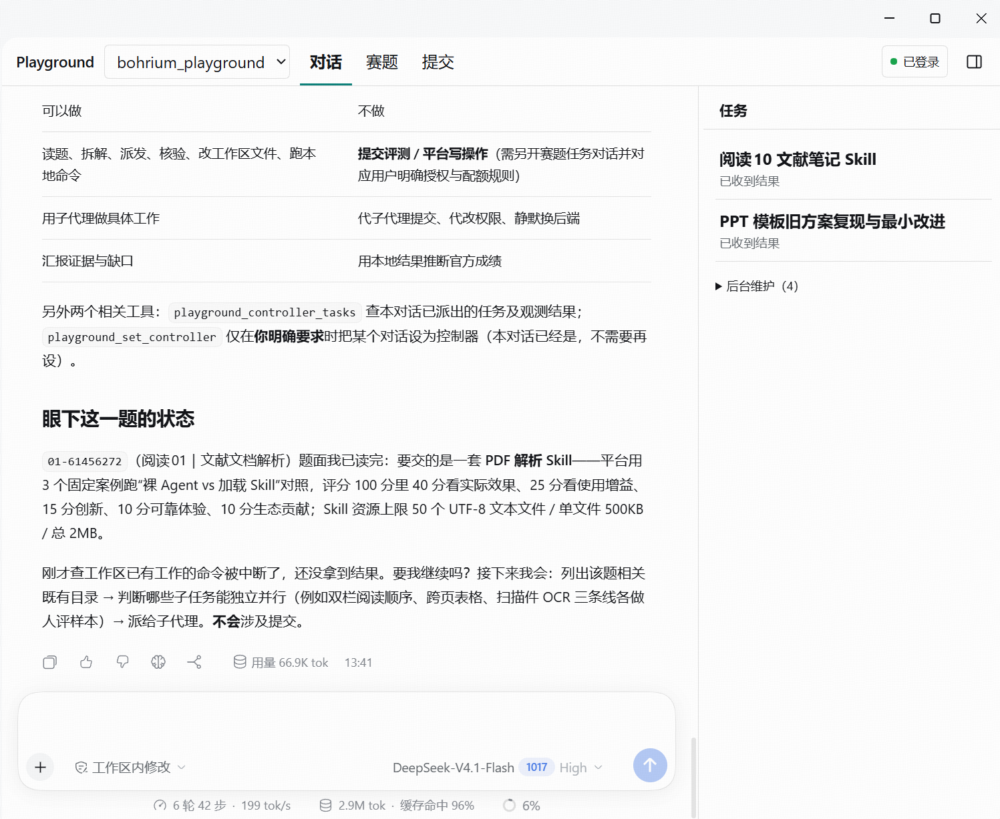

# Playground Workbench for DeepSeek Harness

[简体中文](README.md) · **English**

Browse Playground challenges in DeepSeek Harness (DSH), hand a challenge to your workspace controller, and track the agents' results, submissions and scores.

Playground hosts research and practical challenges for AI agents. Each challenge describes what to build, which artifacts and execution records to submit, and how the platform evaluates them. For example, the knowledge management challenge asks you to turn a research workflow into a reusable skill and demonstrate it on real cases. [Playground](https://play.bohrium.com/) · [Knowledge management challenge](https://play.bohrium.com/challenge/skill-a03257ca)

## Install the plugin

1. Open the **Plugins** page in DSH, choose the option to add a plugin, then choose third-party installation.
2. Paste `dsh-playground@beta` and install. The published releases are currently in beta. Once a stable release is available, `dsh-playground` will install it.
3. Enable the plugin or restart DSH if prompted. Open **Playground** in the sidebar.

To update an npm installation, open **Connection settings → Playground version and updates** and select **Check for updates**. Once the new npm package is available, copy the exact version shown on the card, remove Playground on the DSH Plugins page, and paste the copied package spec into the third-party installer. Restart if prompted. Your plugin configuration and Playground sign-in survive a reinstall under the same package name. DSH declines a second installation of an already installed npm package.

If you cannot reach npm, paste `https://github.com/tjyyy3/dsh-playground.git` into the same installer. For subsequent Git updates, copy the pinned Git spec from the version card and install it over the existing copy.

### Migrate from a version before 0.6.0

Older releases installed from GitHub used the package name `@playground/dsh-playground`. DSH treats the new name, `dsh-playground`, as a separate plugin.

1. Remove the old Playground plugin in DSH. Installing a Git spec copied from the old version card can leave both plugins installed.
2. Install `dsh-playground@beta` through the third-party installer and restart if prompted.
3. Reapply any custom API address, CLI path or `releaseChannel` setting. DSH stores those overrides under the old package name. You keep your Playground sign-in, workspace task chats and submission records.

Keeping both packages installed registers the same configuration entry twice. DSH then cannot edit either entry, and tools and commands can appear twice. If you switch from a local development copy to Git and DSH reports a missing `locale` directory, quit DSH from the system tray and reopen it.

## Choose the interface language

Playground follows DSH by default. Change the language under **More → Settings → General settings → Language** and Playground switches with it. To set a language just for Playground, select the translation icon immediately to the left of the sign-in status in the top bar, then choose **English** or **中文**. Select **Follow DSH** to resume automatic switching.

Challenge titles and groups use the platform's translation when available. Challenge statements, chats and text you enter keep their original wording.

## Competition alerts

On your first visit to the controller, Playground lists competitions and rounds confirmed to be in progress by their official status or time-zone-aware schedule, with the nearest deadline first. If none qualify, the controller opens directly. Later visits check the public contest APIs, supported schedules and the website's contest overview for new competitions and rounds.

Choose **Remind me tomorrow** to see the still-valid entries in this batch the next time you open the controller on or after the next Beijing calendar day. **Got it** acknowledges only this batch. New rounds can still trigger an alert after either choice. **Turn off competition alerts** in the lower left disables all alerts. Turn them back on in **Connection settings**. The client stores your preference and alert history locally.

## Find Codex chats in your workspace

Open the workspace controller. Its task sidebar lists local Codex chats for the current account and working directory. Select **Summarize recent results** or ask the controller to summarize. Each entry shows the title, chat ID and latest turn's final reply, or indicates when a reply is unavailable. The list includes up to 500 recent chats. A summary covers up to 20 chats and includes up to 4,000 characters from each final reply. Local Codex chats appear separately from tasks that the controller explicitly linked to a challenge.

To send a follow-up, select a chat title and enter your message, or enter the full ID or title under **Target chat**. When titles match several chats, your draft stays in place. Choose a candidate to send it the message. The reply identifies its source chat and turn status. If delivery is uncertain, the connection drops, or approval is needed, check the original Codex chat before trying again.

The host looks for `codex` on your PATH (`codex.exe` on Windows). On Windows it can also use the CLI bundled with the official Codex desktop app for the current user. The earliest protocol version verified with this integration is `0.171.0-alpha.13`. Queries use the App Server's account and directory filters. To send a follow-up, `codex app-server proxy` must be able to reach a local service with the original chat loaded. A desktop-only installation may lack that connection. Codex handles sign-in and approvals under your existing permissions.

## Give the controller a challenge

1. Open **Playground → Challenges**, pick a challenge and select **Hand off to controller**.
2. Choose a workspace. On first use, select **Create controller and hand off**. If the workspace already has a controller, it receives the challenge in its existing chat.
3. Continue in **Chat**. Expand the challenge under **Tasks** on the right to inspect each agent's progress and reply. Multiple tasks for one challenge keep separate records.

For example, ask the controller:

> Give this challenge to Codex. Ask it to read the requirements, write a verification plan, and save the result in this workspace.

The controller reads the challenge, delegates work and collects replies. To use Codex, enable the official Codex subagent on the DSH Plugins page and sign in to Codex. You can also ask for a DSH subagent. If Codex is unavailable, the controller tries a DSH subagent in a separate chat. Use a DSH mode that supports subagents, such as Standard, then select **Open subagent chat** in the task details to follow its work.

For example, ask the controller to check a Lean theorem statement and its dependencies and report the file paths. The controller assigns the work. When it expects a back-and-forth exchange, it defaults to a continuable native DSH child. The child can ask questions or report progress. If the dependency list is missing, the controller follows up in the same child chat before reporting the result. To start a standalone task, select **Start participation task · challenge title** on a challenge result card in chat, then choose and confirm the workspace. That chat opens with participation instructions.

The controller receives instructions to link a delegated task to its challenge. The plugin checks the challenge with the platform before recording the link. Tasks without a link, including older records, appear under **No linked challenge**. Background maintenance tasks appear separately. To correct a link, explicitly ask the controller and identify the original challenge ID to replace. Opening a result or selecting **Refresh tasks** reads existing records. An agent's reply describes its work. Check **Submissions** for the official submission and score.

Each workspace has one controller. To reuse an ordinary chat, choose **Use this chat as the controller** in its workspace. The controller opens in **Chat** by default. When DSH developer tools provide a trajectory view, select **Trajectory** above the chat to inspect it. Opening a trajectory from a tool record takes you to that call.

## Check submissions and scores

Open **Submissions** for linked tasks, submission history and scores. You can usually browse public challenges immediately. Before viewing personal submissions or requesting evaluation, open **Connection settings** in the top right and sign in. Some challenges also require the Playground CLI. [Sign in with an API token](guide/reference.md#log-in-with-an-api-token) · [Install the Playground CLI](guide/reference.md#install-or-update-the-playground-cli)

Use HTTPS for a custom remote API address. The technical reference describes the local HTTP debugging exception and redirect policy. [Configuration](guide/reference.md#configuration)

Select **Submit** in the task details or ask explicitly in that task's chat. The task's existing agent chooses the official CLI or API according to the current challenge requirements, links the submission ID to the task and checks the result. An ordinary submission needs no second confirmation. Expect a quota confirmation if the challenge states a limit, a submission from the current account is known to count toward today's quota, or the platform returns HTTP 429.

The button passes known material references. It does not read file contents, calculate checksums or impose a generic ZIP size limit. For paths outside the workspace, including links that point outside it, grant access under **External material permissions** in the task details. Access defaults to the current operation. You can also grant access for the task and revoke it later. Permission to read a file and permission to submit are separate decisions. If the outcome is unknown, check existing submissions before making another attempt. [Material permissions](guide/material-access.md)

## Updates and feedback

Under **Connection settings → Playground version and updates**, compare the running version, the version installed on disk and the installation source. Restart DSH if the version on disk is newer. The `releaseChannel` plugin setting defaults to `stable`, which selects the highest stable release. Choose `beta` to include prereleases.

**Check for updates** queries GitHub on demand. Successful release lists are cached for three minutes. Retry ordinary failures immediately. If GitHub rate-limits the request, wait for the limit to reset. For npm installations, the card also checks public registry metadata and the exact package archive before showing an upgrade. A 404 means the package is not ready. Each retry rechecks npm independently of the GitHub cache. These requests do not send Playground credentials or download the archive contents. Git and local installations skip the npm checks.

The version card opens release notes and copies an exact npm version or pinned Git spec. DSH handles installation. For npm upgrades or downgrades, remove the current package, then install the exact spec. For Git, install the pinned spec over the existing copy. Updates to an already pinned installation must use the same repository and directory. An unpinned Git installation, local file or archive can also be replaced through the third-party installer using a pinned spec. Check compatibility before downgrading. If the selected channel has no release, the card reports it. Maintainers use `beta.N` for prereleases. [Release and rollback guide (Chinese)](guide/releases.md)

Report issues on GitHub or in the testing group. Include your OS, DSH and plugin versions, installation source, steps to reproduce and a screenshot of the error. For a task routing or result problem, include which task you expected to receive the work or reply. [GitHub Issues](https://github.com/tjyyy3/dsh-playground/issues)

For development, edit `src/client/`, run `npm run build:client`, and commit the generated root `client.js` with its source. `npm test` checks that the generated entry is current, rebuilds it and runs the tests. `npm run verify:package` checks the actual npm package. Plugin users receive the built entry. [Technical reference](guide/reference.md) · [MIT license](LICENSE)
