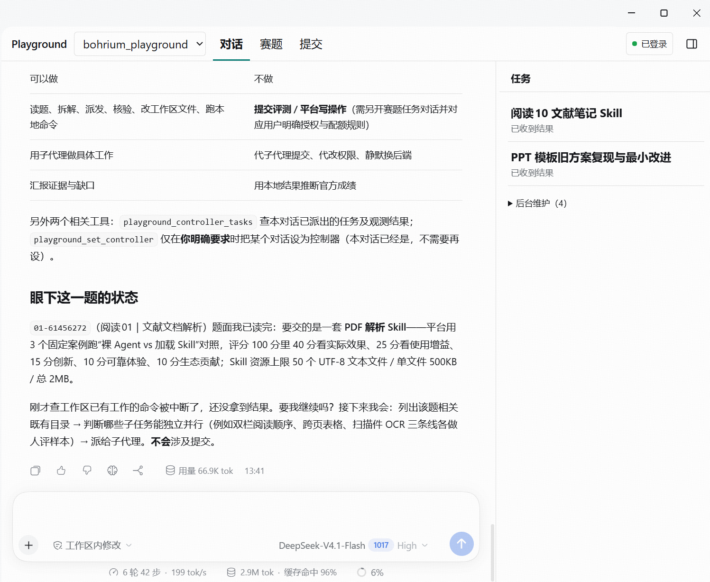

# Playground 比赛助手（DSH 插件）

在 DeepSeek Harness（DSH）里浏览赛题，让工作区主控分派任务、汇总结果，并查看提交历史和评分。

Playground 是一个面向 AI Agent 的科研与实践挑战平台。参赛者按题目要求完成任务，提交产物和执行记录，由平台评测。例如，知识管理赛题要求把整理科研资料的方法做成可复用的 Skill，并用实际案例验证效果。[Playground 官网](https://play.bohrium.com/) · [知识管理 Skill 赛题](https://play.bohrium.com/challenge/skill-a03257ca)

## 安装插件

1. 在 DSH 中打开 **插件 → 添加插件 → 安装第三方插件**。
2. 填入 `dsh-playground@beta`，点击安装。目前只有测试版；正式版发布后，填 `dsh-playground` 即可安装正式版。
3. 安装完成后，按提示启用或重启。左侧导航出现 **Playground** 即可开始使用。

DSH 不会自动更新第三方插件，在安装框再次填写同名插件会提示已安装。更新时打开 Playground 的 **连接设置 → 版本与更新**，点击 **检查更新**。有新版本时，先在 DSH 插件页卸载 Playground，再在第三方插件安装框重新填入 `dsh-playground@beta`（正式版填 `dsh-playground`），按提示重启。卸载和重装不会清除插件配置和 Playground 登录。想固定某个版本，可以填 `dsh-playground@<版本号>`，例如 `dsh-playground@0.6.0-beta.1`。

无法访问 npm 时，也可以在安装框填 `https://github.com/tjyyy3/dsh-playground.git` 从 GitHub 安装。这种来源的更新方式是复制 **版本与更新** 里的 Git spec，填入安装框覆盖安装。

### 从旧版迁移

0.6.0 之前的版本只能从 GitHub 安装，插件包名是 `@playground/dsh-playground`。新版改名为 `dsh-playground`，DSH 会把它当作另一个插件。旧版用户请按以下步骤迁移：

1. 在 DSH 插件页卸载旧的 Playground 插件。不要用旧版本卡片里的 **复制 Git spec** 覆盖安装新版，那样会同时装上新旧两个插件。
2. 在第三方插件安装框填入 `dsh-playground@beta`，安装后按提示重启。
3. 如果改过插件配置（API 地址、CLI 路径或 `releaseChannel`），在新插件中重新设置。旧配置按旧包名保存，新插件不会读取。Playground 登录、工作区里的任务对话和提交记录不受影响。

不要同时保留新旧两个插件。两者注册同一个配置项，DSH 无法编辑其中任何一个，工具和命令也可能重复。

**从本地开发版切换到 Git 安装后**，如果启用时报旧目录的 `locale` 找不到，请从托盘完全退出 DSH，再重新打开。

## 让主控处理一道题

1. 打开 **Playground → 赛题**，选一道题并点击 **交给主控**。
2. 首次使用时，选定工作区并点击 **创建主控并交接**。工作区已有主控时，插件会把赛题发到该对话。
3. 在 **对话** 中继续提要求。在右侧 **主控任务** 展开赛题，查看各个 Agent 的执行情况和返回结果。同题的多个任务分别保留。

主控会收到在派发后登记子任务与赛题关联的指令。若主控遗漏登记，该任务仍保留在 **未关联赛题**，旧记录也保留在这里；后台维护任务单独显示。关联前会向平台核实赛题。更正错误关联需要用户明确提出，并指定要替换的原赛题编号。展开、查看结果和 **刷新任务** 只读取已有记录。收到 Agent 结果不表示比赛已提交或完成评分。

例如，可以对主控说：

> 帮我把这道题交给 Codex，先读题并列一个验证计划。把结果写在当前工作区里。

主控负责读题、派工和汇总。Codex 不可用时，主控会尝试把解题交给 DSH 子智能体，在独立对话中执行。可以在右侧任务详情点 **打开子智能体对话**。请使用支持子智能体的 DSH 模式，例如标准模式。

要用 Codex，在 DSH 的 **插件** 页启用官方 **Codex 子智能体** 并完成 Codex 认证。也可以在主控对话中指定使用 DSH 子智能体。

想沿用已有的普通对话时，可以在该对话所在的工作区点击 **把当前对话设为主控**。每个工作区使用一个主控。

## 查看提交和评分

在 **提交** 页查看已关联的任务、提交历史和评分。浏览公开赛题通常可以直接开始。查看个人提交或提交评测前，打开右上角的 **连接设置**，[登录 Playground](guide/reference.md#log-in-with-an-api-token)。需要 CLI 的题目可安装 [Playground CLI](guide/reference.md#install-or-update-the-playground-cli)。

自定义远程 API 地址必须使用 HTTPS。本机 HTTP 调试例外和重定向策略见[配置说明](guide/reference.md#configuration)。

在参赛任务详情点击 **提交**，插件把本次请求交给该任务现有的 Agent。Agent 根据当前题面和官方要求选择 CLI 或 API，取得编号后关联任务并查询结果。也可以在任务对话中明确要求提交。普通提交无需检查卡或第二次确认；题面限次、当前账号当天已有明确占名额的提交或平台返回 429 时，需要额外答复配额风险。

按钮只传递已知材料引用，不读取文件全文、计算摘要或套用通用 ZIP 大小限制。外部文件或链接到工作区外的材料，需要在任务详情的 **外部材料权限** 中授权。默认仅允许本次操作，也可选择本次任务并随时撤销。读取授权不代表同意提交。结果未知时先核对已有提交，不换路线盲目新建。[材料权限的范围与限制](guide/material-access.md)。

## 更新和反馈

打开 Playground 的 **连接设置**，在 **版本与更新** 中查看运行版本、磁盘版本和安装来源。磁盘版本较新时需要重启 DSH。插件配置 `releaseChannel` 默认是 `stable`，可改为 `beta`。正式渠道选择最高正式版，Beta 选择包含预发布在内的最高版本。Beta 可能不稳定。只有点击 **检查更新** 才会访问 GitHub；成功结果缓存三分钟，普通失败可立即重试，GitHub 限流时等待额度恢复。

卡片只读取信息，可打开发布说明，并按安装来源复制带版本号的 npm spec（如 `dsh-playground@0.6.0-beta.1`）或 Release 提供的固定 Git spec。安装和更新由 DSH 插件管理器负责，插件不会下载或安装更新。npm 来源需要卸载后重新安装。固定 Git 来源的更新目标必须来自同一仓库和目录；未固定 Git、本地文件和压缩包来源可通过第三方插件安装框覆盖安装固定 spec。降级前请核对兼容性，npm 来源卸载后安装 `dsh-playground@<旧版本号>`，Git 来源用旧版固定 spec 覆盖安装。卡片没有安装按钮。暂无发布时会明确提示。

维护者的发版及回退验证流程见 [发布指南](guide/releases.md)。当前版本是 `0.6.0-beta.1`，预发布统一使用 `beta.N`。

欢迎在 [GitHub Issues](https://github.com/tjyyy3/dsh-playground/issues) 或试用群反馈。请带上操作系统、DSH 和插件版本、安装来源、复现步骤及错误截图。我们尤其想知道安装或登录卡在哪一步、任务是否派错或重复、结果有没有回来。

工具、配置和开发测试见 [技术参考](guide/reference.md)。项目采用 [MIT 许可证](LICENSE)。
