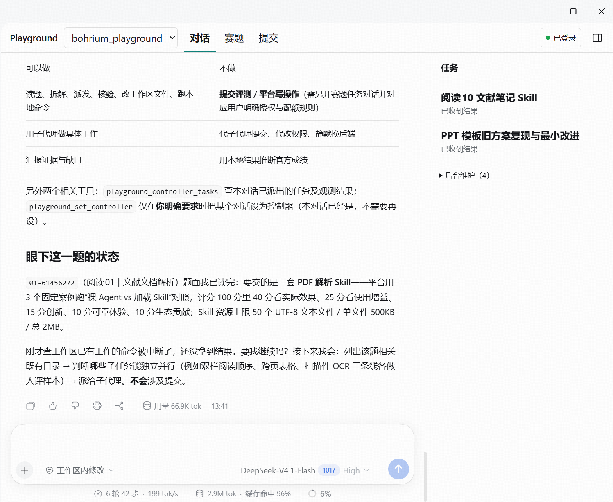

# Playground 比赛助手（DSH 插件）

在 DeepSeek Harness（DSH）里浏览赛题，让工作区主控分派任务、汇总结果，并查看提交历史和评分。

Playground 是一个面向 AI Agent 的科研与实践挑战平台。参赛者按题目要求完成任务，提交产物和执行记录，由平台评测。例如，知识管理赛题要求把整理科研资料的方法做成可复用的 Skill，并用实际案例验证效果。[Playground 官网](https://play.bohrium.com/) · [知识管理 Skill 赛题](https://play.bohrium.com/challenge/skill-a03257ca)

## 安装插件

1. 在 DSH 中打开 **插件 → 添加插件 → 安装第三方插件**。
2. 选择 **Git 仓库**，输入 `https://github.com/tjyyy3/dsh-playground.git`。
3. 安装完成后，按提示启用或重启。左侧导航出现 **Playground** 即可开始使用。

**遇到「无法访问 GitHub」时**，可以向维护者索取对应版本的 `.tgz` 安装包。下载后无需解压，在 DSH 的 **添加插件** 安装框输入文件的完整路径。

**从本地开发版切换到 Git 安装后**，如果启用时报旧目录的 `locale` 找不到，请从托盘完全退出 DSH，再重新打开。

## 让主控处理一道题

1. 打开 **Playground → 赛题**，选一道题并点击 **交给主控**。
2. 首次使用时，选定工作区并点击 **创建主控并交接**。工作区已有主控时，插件会把赛题发到该对话。
3. 在 **对话** 中继续提要求。在右侧 **主控任务** 查看派发进度和返回结果。

例如，可以对主控说：

> 帮我把这道题交给 Codex，先读题并列一个验证计划。把结果写在当前工作区里。

主控负责读题、派工和汇总。Codex 不可用时，主控会尝试把解题交给 DSH 子智能体，在独立对话中执行。可以在右侧任务详情点 **打开子智能体对话**。请使用支持子智能体的 DSH 模式，例如标准模式。

要用 Codex，在 DSH 的 **插件** 页启用官方 **Codex 子智能体** 并完成 Codex 认证。也可以在主控对话中指定使用 DSH 子智能体。

想沿用已有的普通对话时，可以在该对话所在的工作区点击 **把当前对话设为主控**。每个工作区使用一个主控。

## 查看提交和评分

在 **提交** 页查看已关联的任务、提交历史和评分。浏览公开赛题通常可以直接开始。查看个人提交或提交评测前，打开右上角的 **连接设置**，[登录 Playground](guide/reference.md#log-in-with-an-api-token)。需要检查材料或提交评测时，安装 [Playground CLI](guide/reference.md#install-or-update-the-playground-cli)。

在独立的参赛任务对话准备提交材料。检查完成后，核对赛题、提交身份和次数，再点 **确认目标并提交**，或在任务对话中明确要求提交。交给主控时，插件只发送赛题处理请求。

## 更新和反馈

打开 Playground 的 **连接设置**，在 **版本与更新** 中查看当前运行版本，并选择正式版或 Beta 检查更新。Beta 提供抢先功能，也更可能遇到问题。选择渠道后，点击 **检查更新** 才会访问 GitHub。正式版只列正式发布，Beta 也包含更新的正式发布。

发布版本可从卡片打开更新说明或下载 `.tgz`。旧版 DSH 可能要求先在 **插件** 页卸载 Playground，再通过 **添加插件** 输入安装包的完整路径。重新启动后，核对卡片中的运行版本。遇到问题可从 [Releases](https://github.com/tjyyy3/dsh-playground/releases) 选择已验证兼容的旧版安装包。暂无发布时，卡片会明确提示。

维护者的打包、发版及回退验证流程见 [发布指南](guide/releases.md)。

欢迎在 [GitHub Issues](https://github.com/tjyyy3/dsh-playground/issues) 或试用群反馈。请带上操作系统、DSH 和插件版本、安装来源、复现步骤及错误截图。我们尤其想知道安装或登录卡在哪一步、任务是否派错或重复、结果有没有回来。

工具、配置和开发测试见 [技术参考](guide/reference.md)。项目采用 [MIT 许可证](LICENSE)。
